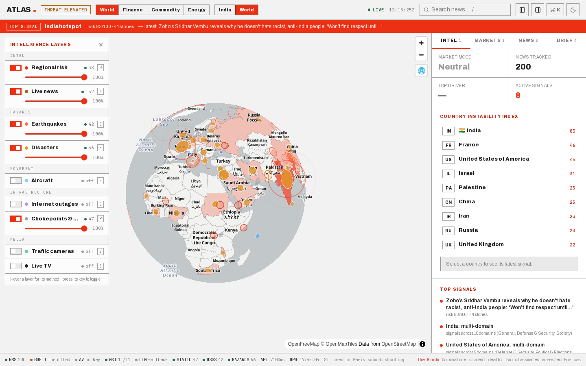
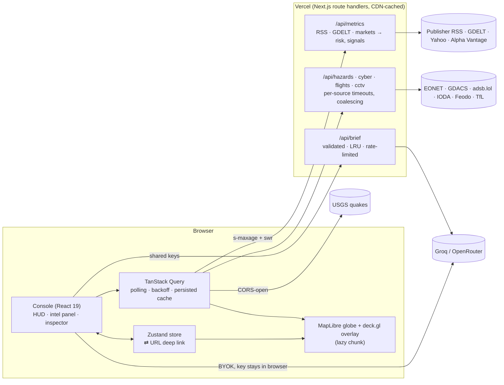

# Atlas 🌍

[](https://github.com/WickTech/Atlas/actions/workflows/ci.yml)
[](https://github.com/WickTech/Atlas/actions/workflows/security.yml)
[](https://atlas-eight-fawn.vercel.app)


Real-time global situational-awareness console — country risk, cross-stream signals, markets and world news on a GPU-rendered globe. Built entirely on free, keyless, open data and deployed as a zero-config Next.js app on Vercel.

**Live:** https://atlas-eight-fawn.vercel.app



## Stack

- **Next.js 16** (App Router) + **React 19** + **TypeScript** (strict, `noUncheckedIndexedAccess`)
- **Tailwind CSS v4** — Modernist design tokens (ink / red / Archivo, 0 radius) + HUD layer (JetBrains Mono telemetry, glass map overlays)
- **MapLibre GL v5 + deck.gl 9** — one WebGL context: native feature-state choropleth for risk, deck.gl layers interleaved on the globe (MapLibre v6 drops the `map.transform` API deck.gl's overlay needs, so v5 is pinned until deck.gl supports it)
- **Zustand** — control state (layers, filters, camera, selection, telemetry) with debounced two-way **URL sync** for shareable deep links
- **TanStack Query** — polling that pauses in background tabs, exponential backoff, last-good-data retention
- **Vitest** — unit tests for the whole server data pipeline · **Playwright** — production smoke tests in CI

## Data sources (all free)

| Source | Used for | Key | Terms |
| --- | --- | --- | --- |
| Publisher RSS (The Hindu, NDTV, TOI, Mint, ET, BBC, Al Jazeera, DW, France 24, Guardian, NPR, UN News) | News backbone, subject-country tagging | none | Headlines + links only, per publisher terms |
| GDELT DOC 2.0 | Supplementary world news + tone (throttled to 1 req / 5 s per IP, so best-effort) | none | Open use with citation |
| Yahoo Finance chart API | India + global markets | none | Unofficial endpoint, Yahoo terms |
| Alpha Vantage | Per-article sentiment, top gainer | optional `ALPHA_VANTAGE_API_KEY` | Free tier terms |
| Groq / OpenRouter (`openrouter/free`) | AI briefs, deterministic fallback otherwise | optional `GROQ_API_KEY` / `OPENROUTER_API_KEY` | Provider terms |
| OpenFreeMap (OSM) · CARTO fallback | Vector basemaps | none | ODbL (OSM data), attribution shown on map |
| USGS real-time feed | Earthquakes M2.5+ (browser-direct, CORS-open) | none | U.S. public domain |
| NASA EONET · GDACS | Natural events + disaster impact alerts (via `/api/hazards`) | none | NASA open data · GDACS free use with attribution |
| adsb.lol | Live aircraft in the visible area (via `/api/flights`) | none | ODbL |
| IODA (Georgia Tech) · abuse.ch Feodo Tracker | Internet outages by country, botnet C2 hosting (via `/api/cyber`) | none | IODA terms · CC0 |
| TfL JamCams | London traffic-camera stills (via `/api/cctv`) | none | Open Government Licence ("Powered by TfL Open Data") |
| YouTube live embeds | 24/7 news channels (privacy-enhanced `youtube-nocookie`) | none | YouTube terms |
| U.S. EIA · Lloyd's List · ICG CrisisWatch | Static reference: chokepoints, major ports, flashpoint areas | none | Cited reference figures, labelled static in the UI |

## Architecture



```
app/
  page.tsx               static shell → <Console/> (client)
  api/metrics/route.ts   aggregated payload; CDN cached (s-maxage=60, swr=300)
  api/brief/route.ts     AI brief on shared free-tier keys: validated input, 15 min LRU, 8 req/min/IP
  api/{hazards,cyber,cctv,flights}/route.ts
                         live-layer proxies: per-source timeouts, in-instance coalescing,
                         CDN s-maxage tuned per feed (10 s flights … 1 h cameras)
  api/health/route.ts
src/
  server/                data pipeline: fetchers (all via fetchWithTimeout), RSS parser,
                         country gazetteer, risk index, signals, sentiment, LLM chain, TTL cache
  state/                 Zustand store + typed contracts + URL sync
  layers/                registry (label, hotkey, method, source) → dock/palette/help;
                         pure upstream parsers → normalized GeoItem; useLiveLayers queries
  map/                   MapCanvas (dynamic import, ssr: false), deck.gl layer factories, geometry
  components/hud/        top bar, layer dock, tabbed intel panel / mobile sheet, status rail, palette
  components/modules/    risk index, signals, markets, news feed, briefs
  types/metrics.ts       wire contract shared by server and client
```

Resilience: every upstream self-falls-back; the route coalesces concurrent cold requests into one fetch, serves the last good payload on failure, and keeps the last real news feed if a refresh comes back empty.

## Console

- Full-bleed globe with a floating **layer dock** (live entity counts, status, opacity), a docked **intel panel** (Intel · Markets · News · Brief), and a **status rail** showing which sources contributed to the current refresh, API latency and a headline tape.
- **Nine layers** in five groups: regional risk, live news, earthquakes, disasters, aircraft, internet outages, chokepoints & ports, traffic cameras, live TV. Each fetches only while it's on, polls at a cadence matched to its source, pauses in background tabs, and reports status/count/errors to the dock. Small slow-moving layers persist to localStorage and repaint instantly on reload.
- Aircraft are fetched for the visible box only (zoom ≥ 4, 2°-quantized so pans share cache keys) and drawn radar-style: a dot at barometric altitude plus a heading tail scaled to ground speed.
- Click a camera or TV marker for a floating viewer (map stays interactive). Click anything else, pick a country, or press `G` and click any point to open the **inspector**. It shows facts and the source link, the country found by point-in-polygon on the loaded geometry, events within 500 km by great-circle distance, a coverage/event timeline, and the latest matching headlines.
- **AI situational brief** on demand. It's generated only from the facts and headlines the inspector shows: the prompt forbids outside knowledge and treats headline text as data. It uses Atlas's shared free-tier keys through `/api/brief` (input validation, LRU cache, per-IP rate limit, rule-based fallback). With **bring your own key**, the browser calls Groq or OpenRouter directly (both allow CORS), so the key stays in localStorage and never reaches Atlas's server.
- Radar pings on the busiest news hotspots are MapLibre DOM markers animated purely in CSS (compositor thread, zero per-frame JS, off under `prefers-reduced-motion`).
- Rendering notes: deck.gl primitives are lifted 3 km off the globe so they don't z-fight with MapLibre's sphere, and aircraft tails use `PathLayer` because `LineLayer` doesn't draw under the globe projection.
- Every view is a URL: `?l=risk,news&v=20,25,1.6&s=world&c=France` restores layers, camera, scope and selection.
- Keyboard: `⌘K` palette · `/` search · `[` `]` panels · `1–4` tabs · `G` pick a location · layers `R` `N` `E` `H` `F` `C` `P` `V` `B` · `Esc` · `?` help.

## Quality gates

Every push and PR runs [`ci.yml`](.github/workflows/ci.yml) (typecheck → lint → Vitest → build → initial-JS budget → Playwright smoke) and [`security.yml`](.github/workflows/security.yml) (gitleaks + Semgrep).

- **Initial JS budget:** `npm run size` sums the gzip size of every script the prerendered page loads (skipping `noModule` polyfills, which modern browsers never fetch) and fails above 180 kB. Currently ~165 kB; MapLibre, deck.gl, the inspector, palette, help, media viewer and asset drawer are all lazy chunks.
- **Playwright smoke** (`e2e/`): health endpoint, shell renders with no uncaught errors and the WebGL globe mounts (SwiftShader on CI), URL deep link ⇄ layer toggles, and the lazily loaded ⌘K palette.
- **Lighthouse** (local production build, desktop preset): Accessibility 95 · Best Practices 100 · SEO 100 · CLS 0 (desktop and mobile). The performance score is dominated by the WebGL globe, which headless Lighthouse renders on the CPU (SwiftShader), so it says little about real GPUs.
- Layout stability: the top-signal row and threat chip reserve their space before data arrives, so the map doesn't jump on load (CLS was 0.32 before).

## Develop

```bash
npm install
cp .env.example .env.local   # optional keys
npm run dev                  # http://localhost:3000
npm run typecheck && npm run lint && npm test && npm run build
npm run size                 # initial JS budget (after build)
npx playwright install chromium --only-shell
npm run test:e2e             # smoke tests against `next start`
```

Feature concepts adapted from [koala73/worldmonitor](https://github.com/koala73/worldmonitor) (AGPL-3.0) — ideas only, no code copied.
